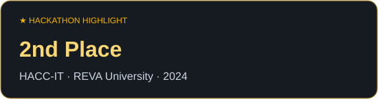
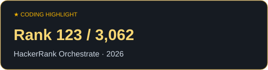

<table><tr><td width="60%" valign="top">

I’m **Vinay**, a Computer Science student at **REVA University, Bengaluru**. I build AI applications and explore what happens after a model makes a prediction: who can check it, and what should the software do next?

- 🔭 Exploring **computer vision, generative AI & agent systems**
- 🛠️ Building **AASHA, MPLADS Sentinel & AgentPay** prototypes
- 🏆 **2nd place** — REVA HACC-IT internal hackathon
- 💻 Practicing **data structures & algorithms** across coding platforms
- 🌱 Learning through **hackathons, experiments & full-stack projects**
- 📫 **lokeshvinay1973@gmail.com**

</td><td width="40%" align="center">

</td></tr></table>

### Languages

### Frameworks & Libraries

### Data, Cloud & Tools

 

 
<table><tr><td width="50%" valign="top">

### 💙 [AASHA](https://github.com/Vinay-711/AASHA)
A health and personal-safety research prototype exploring **medication reminders, pharmacy reports & family workflows**.

`Flutter` `Python` `FastAPI` · [**Browser demo ↗**](https://vinay-711.github.io/AASHA/)

</td><td width="50%" valign="top">

### 🛰️ [MPLADS Sentinel](https://github.com/Vinay-711/mplads-sentinel-sih-2026)
A research and hackathon prototype for **public-works data, project monitoring & risk indicators** that support human review.

`Python` `PostgreSQL` `FastAPI`

</td></tr><tr><td width="50%" valign="top">

### 🤖 [AgentPay](https://github.com/Vinay-711/AgentPay)
A hackathon prototype exploring **agent-to-agent payments**, with policy-constrained wallets and AgentGuard checks on Monad testnet.

`React` `Solidity` `AI Agents`

</td><td width="50%" valign="top">

### 🧩 [DSA Practice](https://github.com/Vinay-711/Leetcode)
My coding practice: **Java solutions, algorithm explanations & edge cases**, with separate repositories for each platform.

`Java` `Algorithms` `Problem Solving`

</td></tr></table>

<picture>
<source media="(prefers-color-scheme: dark)" srcset="./assets/github-snake-dark.svg" />

</picture>

Hackathon highlights

- **2nd place** at REVA University’s HACC-IT internal hackathon, November 2024.
- **Rank 123 of 3,062** at HackerRank Orchestrate, September 2026.

Competitive programming profiles and practice repositories

I keep solution code, original explanations, edge-case tests, and submission results in a separate repository for each platform.

| Platform | My profile | Practice repository |
| --- | --- | --- |
| **Codeforces** | [vinay711](https://codeforces.com/profile/vinay711) | [codeforces-daily](https://github.com/Vinay-711/codeforces-daily) |
| **LeetCode** | [\_\_vinxy\_](https://leetcode.com/u/__vinxy_/) | [leetcode-daily](https://github.com/Vinay-711/leetcode-daily) · [Java solutions](https://github.com/Vinay-711/Leetcode) |
| **CodeChef** | [flair_ref_46](https://www.codechef.com/users/flair_ref_46) | [codechef-daily](https://github.com/Vinay-711/codechef-daily) |
| **HackerRank** | [lokeshvinay1973](https://www.hackerrank.com/profile/lokeshvinay1973) | [hackerrank-daily](https://github.com/Vinay-711/hackerrank-daily) |
| **HackerEarth** | [lokeshvinay1973](https://www.hackerearth.com/@lokeshvinay1973) | [hackerearth-daily](https://github.com/Vinay-711/hackerearth-daily) |

Practice repositories include AI-assisted work. Judge verdicts are recorded separately from locally tested or unsubmitted solutions. Practice activity is distinct from rated contest participation.

  

 Layout inspired by <a href="https://github.com/zynssam/zynssam">zynssam</a> · Artwork personalized for Vinay

