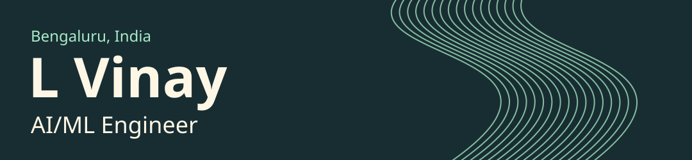

  

  <a href="https://www.linkedin.com/in/l-vinay-55631136b/">LinkedIn</a> &nbsp;·&nbsp;
  <a href="mailto:lokeshvinay1973@gmail.com">Email</a> &nbsp;·&nbsp;
  <a href="https://github.com/Vinay-711?tab=repositories">All repositories</a>

## Hi, I'm Vinay

I'm a **third-year Computer Science & Engineering student at REVA University**, based in **Bengaluru, India**. I build AI, automation and full-stack projects, with a particular interest in healthcare workflows, public-interest data systems, and tools that turn an idea into a working demonstration.

Hackathons are where I explore new ideas. Testing, documentation and iteration are how I make those ideas easier to run, understand and improve.

- **Building:** database-backed web applications, AI-assisted prototypes, and developer workflows.
- **Exploring:** generative AI, AWS, agent systems, and mobile experiences.
- **Practising:** data structures, algorithms, and explaining solutions clearly.
- **Open to:** student collaborations, hackathons, and practical open-source contributions.

## Selected projects

| Project | What I'm building | Technology & scope |
| --- | --- | --- |
| **[SocietyBuy](https://github.com/Vinay-711/societybuy)** | Society grocery ordering, supply-chain operations, and transactional order workflows. | Next.js · TypeScript · PostgreSQL. Local demonstration with sandbox integrations and automated checks. |
| **[MPLADS Sentinel](https://github.com/Vinay-711/mplads-sentinel-sih-2026)** | Public-project data pipelines and explainable governance risk indicators. | Python · FastAPI · PostgreSQL. Research prototype that includes demonstration data. |
| **[AASHA](https://github.com/Vinay-711/AASHA)** | Medication-reminder, pharmacy-availability, and family/guardian workflow experiments. | Flutter · FastAPI · SQLAlchemy. Healthcare and safety research prototype. [Browser demo ↗](https://vinay-711.github.io/AASHA/) |
| **[AgentPay](https://github.com/Vinay-711/AgentPay)** | Agent-to-agent services and payments with programmable wallet limits and policy checks. | Solidity · React · FastAPI · Supabase. Monad testnet prototype. |

These projects are at different stages of development. Healthcare capabilities remain unvalidated, payment experiments use test environments, and repository READMEs document the current limitations.

## Tools I work with

| Area | Technologies |
| --- | --- |
| **Languages** | Python, Java, TypeScript, JavaScript, SQL; Solidity for testnet experiments |
| **Web & APIs** | React, Next.js, FastAPI, REST APIs |
| **Data & backend** | PostgreSQL, SQLAlchemy, Supabase |
| **Mobile & AI exploration** | Flutter, computer vision, generative AI, agent workflows |
| **Engineering workflow** | Git, GitHub Actions, pytest, Vitest, Playwright |
| **Currently exploring** | AWS and practical AI automation |

## Coding practice

I keep solution code, original explanations, edge-case tests, and submission results in a separate repository for each platform.

| Platform | My profile | Practice repository |
| --- | --- | --- |
| **Codeforces** | [vinay711](https://codeforces.com/profile/vinay711) | [codeforces-daily](https://github.com/Vinay-711/codeforces-daily) |
| **LeetCode** | [\_\_vinxy\_\_](https://leetcode.com/u/__vinxy_/) | [leetcode-daily](https://github.com/Vinay-711/leetcode-daily) · [Java solutions](https://github.com/Vinay-711/Leetcode) |
| **CodeChef** | [flair_ref_46](https://www.codechef.com/users/flair_ref_46) | [codechef-daily](https://github.com/Vinay-711/codechef-daily) |
| **HackerRank** | [lokeshvinay1973](https://www.hackerrank.com/profile/lokeshvinay1973) | [hackerrank-daily](https://github.com/Vinay-711/hackerrank-daily) |
| **HackerEarth** | [lokeshvinay1973](https://www.hackerearth.com/@lokeshvinay1973) | [hackerearth-daily](https://github.com/Vinay-711/hackerearth-daily) |

Practice repositories include AI-assisted work. Judge verdicts are recorded separately from locally tested or unsubmitted solutions; practice activity is distinct from rated contest participation.

## Hackathons & achievements

Results below reflect my certificates. Participation and appreciation certificates are listed as such, rather than as podium finishes.

| Event | Result | Date / edition |
| --- | --- | --- |
| **HACC-IT Internal Hackathon**, REVA University — *AI for Good and Sustainable Development* | **2nd Place** | 7–8 November 2024 |
| **HackerRank Orchestrate** | **Final rank 123 of 3,062** | September 2026 |
| **Code Crusade 2025 Hackathon**, REVA University | Participation | 21–22 November 2025 |
| **OpenSwarm Hackathon**, Polaris School of Technology | Participation · Team Asgard | 18 July 2026 |
| **PBCTF 5.0 — Capture The Flag**, Point Blank | Participation | 26 July 2026 |
| **Bharatiya Antariksh Hackathon**, ISRO / Hack2skill | Participation & successful idea submission | 2026 |
| **Build for Bengaluru**, GDG Bengaluru | Participation | 25–26 April; year not printed on certificate |
| **HACK $DAY Edition 1 — Pondy** | Certificate of Appreciation | Edition 1 |

## Education

**REVA University · Bengaluru**

Computer Science & Engineering · Third year

## Let's connect

Interested in building something useful together? Reach me on **[LinkedIn](https://www.linkedin.com/in/l-vinay-55631136b/)** or at **[lokeshvinay1973@gmail.com](mailto:lokeshvinay1973@gmail.com)**.

Ideas are the starting point. Working software, clear evidence and steady improvement are the goal.

