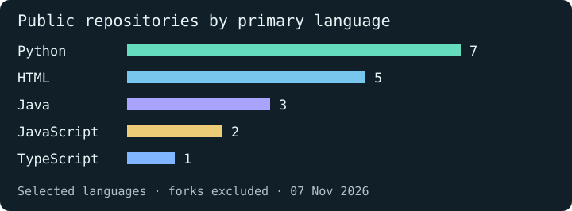

I build AI applications at REVA University in Bengaluru. I’m interested in the moment a model’s output becomes someone’s decision. My projects explore what a reviewer can check, what a user can try, and what an agent is allowed to do.

[LinkedIn](https://www.linkedin.com/in/l-vinay-55631136b/) · [Email](mailto:lokeshvinay1973@gmail.com) · [All repositories](https://github.com/Vinay-711?tab=repositories)

## Try AASHA

How would you help a family member keep track of medication reminders and find a pharmacy? AASHA is a Flutter and FastAPI prototype exploring that workflow. The browser demo uses sample pharmacy reports. The backend has a separate regression suite for the database-backed service.

**[Open the browser demo →](https://vinay-711.github.io/AASHA/)** · [Read the source](https://github.com/Vinay-711/AASHA) · [Run the pharmacy tests](https://github.com/Vinay-711/AASHA#run-the-pharmacy-regression-suite)

## Inside two engineering decisions

| Project | Design decision | Explore it |
| --- | --- | --- |
| **MPLADS Sentinel** · Python, PostgreSQL | Spending and reported progress can move at different rates. Sentinel calculates the gap so a reviewer can decide which public works records deserve a closer look. | [Reproduce the calculations on sample data](https://github.com/Vinay-711/mplads-sentinel-sih-2026#reproduce-the-feature-checks) |
| **AgentPay** · Solidity, FastAPI | An agent can request a payment on Monad testnet. A separate policy engine checks the recipient and spending limit before that request reaches the wallet. | [Inspect the policy tests](https://github.com/Vinay-711/AgentPay/blob/main/backend/tests/test_policy_safety.py) |

## Development stack

 &nbsp;  &nbsp;  &nbsp;  &nbsp;  &nbsp; 

Python · FastAPI · PostgreSQL · React · Flutter · Git

## Repository activity

[Explore the public repositories](https://github.com/Vinay-711?tab=repositories)

## Hackathon highlights

- **2nd place** at REVA University’s HACC-IT internal hackathon, November 2024.
- **Rank 123 of 3,062** at HackerRank Orchestrate, September 2026.

Competitive programming profiles and practice repositories

I keep solution code, original explanations, edge-case tests, and submission results in a separate repository for each platform.

| Platform | My profile | Practice repository |
| --- | --- | --- |
| **Codeforces** | [vinay711](https://codeforces.com/profile/vinay711) | [codeforces-daily](https://github.com/Vinay-711/codeforces-daily) |
| **LeetCode** | [\_\_vinxy\_](https://leetcode.com/u/__vinxy_/) | [leetcode-daily](https://github.com/Vinay-711/leetcode-daily) · [Java solutions](https://github.com/Vinay-711/Leetcode) |
| **CodeChef** | [flair_ref_46](https://www.codechef.com/users/flair_ref_46) | [codechef-daily](https://github.com/Vinay-711/codechef-daily) |
| **HackerRank** | [lokeshvinay1973](https://www.hackerrank.com/profile/lokeshvinay1973) | [hackerrank-daily](https://github.com/Vinay-711/hackerrank-daily) |
| **HackerEarth** | [lokeshvinay1973](https://www.hackerearth.com/@lokeshvinay1973) | [hackerearth-daily](https://github.com/Vinay-711/hackerearth-daily) |

Practice repositories include AI-assisted work. Judge verdicts are recorded separately from locally tested or unsubmitted solutions. Practice activity is distinct from rated contest participation.

