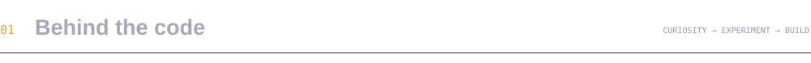
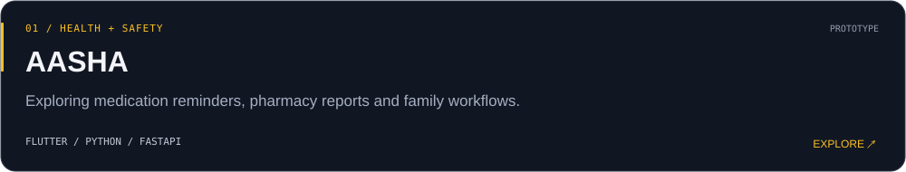
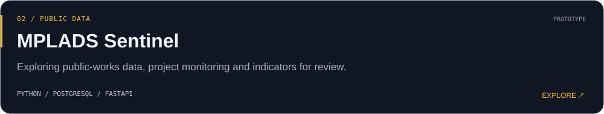
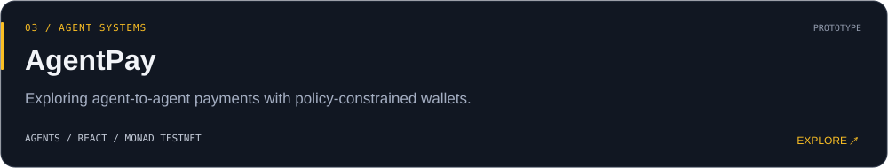
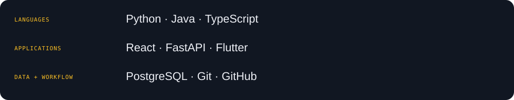

  

  <a href="https://www.linkedin.com/in/l-vinay-55631136b/">LinkedIn ↗</a> &nbsp; / &nbsp;
  <a href="mailto:lokeshvinay1973@gmail.com">Say hello ↗</a> &nbsp; / &nbsp;
  <a href="https://vinay-711.github.io/AASHA/">Try AASHA ↗</a>

I’m **Vinay**, building AI applications at **REVA University, Bengaluru**.

My favorite question comes *after* the prediction: **who can check it, and what should the software do next?** I explore that through computer vision, generative AI, agent systems, and full-stack applications.

- **Building around:** health and safety, public data, and agent workflows.
- **Learning through:** prototypes, hackathons, and competitive programming.
- **Interested in:** useful AI, clear interfaces, and systems people can understand.

<a href="https://github.com/Vinay-711?tab=repositories">Explore all repositories →</a>

<picture>
  <source media="(prefers-color-scheme: dark)" srcset="./assets/github-snake-dark.svg" />
  
</picture>

Built from my GitHub contribution calendar · refreshed daily

Hackathon highlights

- **2nd place** at REVA University’s HACC-IT internal hackathon, November 2024.
- **Rank 123 of 3,062** at HackerRank Orchestrate, September 2026.

Competitive programming profiles and practice repositories

I keep solution code, original explanations, edge-case tests, and submission results in a separate repository for each platform.

| Platform | My profile | Practice repository |
| --- | --- | --- |
| **Codeforces** | [vinay711](https://codeforces.com/profile/vinay711) | [codeforces-daily](https://github.com/Vinay-711/codeforces-daily) |
| **LeetCode** | [\_\_vinxy\_](https://leetcode.com/u/__vinxy_/) | [leetcode-daily](https://github.com/Vinay-711/leetcode-daily) · [Java solutions](https://github.com/Vinay-711/Leetcode) |
| **CodeChef** | [flair_ref_46](https://www.codechef.com/users/flair_ref_46) | [codechef-daily](https://github.com/Vinay-711/codechef-daily) |
| **HackerRank** | [lokeshvinay1973](https://www.hackerrank.com/profile/lokeshvinay1973) | [hackerrank-daily](https://github.com/Vinay-711/hackerrank-daily) |
| **HackerEarth** | [lokeshvinay1973](https://www.hackerearth.com/@lokeshvinay1973) | [hackerearth-daily](https://github.com/Vinay-711/hackerearth-daily) |

Practice repositories include AI-assisted work. Judge verdicts are recorded separately from locally tested or unsubmitted solutions. Practice activity is distinct from rated contest participation.

Have an interesting problem, a hackathon idea, or a project to collaborate on?

<a href="mailto:lokeshvinay1973@gmail.com"><b>Let’s talk →</b></a> &nbsp; · &nbsp; <a href="https://www.linkedin.com/in/l-vinay-55631136b/">Find me on LinkedIn</a>

Always curious. Always building.

